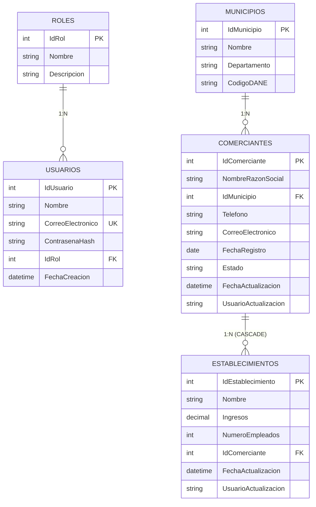

# Prueba Técnica Integral Fullstack (T-SQL - .NET 8 - Angular 18)
## Agremiación Nacional de Comercio | OL Software

Solución completa, robusta y profesional desarrollada para la prueba técnica integral fullstack, estructurada rigurosamente en sus tres fases correspondientes:

1. **`database/`** - Evaluación T-SQL Fullstack (Microsoft SQL Server 2019 / 2022)
2. **`backend/`** - Evaluación .NET Fullstack (.NET 8, Clean Architecture, SOLID, EF Core, JWT, Swagger, xUnit, Docker)
3. **`frontend/`** - Evaluación Angular Fullstack (Angular 18, TypeScript, Signals, SCSS, Jest, OWASP, Estado Global)

---

## 📊 Matriz de Cumplimiento de Retos

| Reto / Componente | Descripción | Estado |
|---|---|:---:|
| **Reglas Generales** | SQL Server, .NET 8, Angular 18, Clean Architecture, Principios SOLID, OWASP TOP 10 | ✅ Cumplido |
| **Reto 01** | Modelo de Datos relacional, normalización, campos de auditoría, índices y MER | ✅ Cumplido |
| **Reto 02** | Identificadores tipo `IDENTITY` a nivel de BD y triggers de auditoría DML (`AFTER INSERT, UPDATE`) | ✅ Cumplido |
| **Reto 03** | Datos semilla aleatorios (2 usuarios uno por rol, 5 comerciantes y 10 establecimientos) | ✅ Cumplido |
| **Reto 04** | Procedimiento Almacenado y Función T-SQL de Reporte con métricas agregadas y orden descendente | ✅ Cumplido |
| **Reto 05** | Web API: Seguridad con JWT (expiración exacta de 1 hora), RBAC y política CORS | ✅ Cumplido |
| **Reto 06** | Web API: Listas de valores para Municipio con Caché en Memoria (`IMemoryCache`) | ✅ Cumplido |
| **Reto 07** | Web API: CRUD Comerciante (paginado de 5 por defecto, filtros, auditoría JWT, PATCH estado, borrado Admin) | ✅ Cumplido |
| **Reto 08** | Web API: Reporte de Comerciantes Activos en archivo plano CSV con separador pipe (`\|`) (Admin) | ✅ Cumplido |
| **Reto 09** | Angular: Página de Login (OWASP, términos y condiciones obligatorios, JWT ofuscado, header usuario/rol) | ✅ Cumplido |
| **Reto 10** | Angular: Página Home (tabla interactiva, paginado 5/10/15, filtros, acciones por rol, descarga CSV) | ✅ Cumplido |
| **Reto 11** | Angular: Formulario dinámico creación/edición y footer inferior con totales de establecimientos | ✅ Cumplido |
| **Pruebas Unitarias** | Mínimo requeridas: 11 en Backend (xUnit + Moq + FluentAssertions) + 11 en Frontend (Jest) | ✅ Cumplido |
| **Compilado Distribución** | Archivo comprimido `comerciantes-frontend-prod.zip` para producción | ✅ Cumplido |
| **Docker & Orquestación** | Dockerfile en Backend, Dockerfile en Frontend y orquestador multi-servicio `docker-compose.yml` | ✅ Cumplido |
| **Entrega Final** | Envío de ruta de repositorio público al correo de la convocatoria | ⏳ Pendiente |

---

## ✅ Checklist de Objetivos de la Prueba Técnica

### 1. Fase Base de Datos: T-SQL (SQL Server)

#### Reglas Generales de Base de Datos
- [x] Utilizar SQL Server (compatible con SQL Server 2019, 2022 y Azure SQL).
- [x] Definir los índices que considere necesarios (`IX_Comerciantes_Estado_FechaRegistro`, `IX_Comerciantes_NombreRazonSocial`, `IX_Establecimientos_IdComerciante`, `IX_Usuarios_CorreoElectronico`, `IX_Municipios_Nombre`).
- [x] Sentencias DML y DDL consignadas en archivos `.sql` organizados y numerados secuencialmente.
- [x] Script maestro `00_init_database.sql` para replicación desatendida en ambientes de calificación.

#### RETO 01: Modelo de Datos
- [x] Diseñar modelo de datos para la entidad `Usuario`: Nombre, Correo Electrónico (Unique), Contraseña (Hash) y Rol (`Administrador` o `Auxiliar de Registro`).
- [x] Diseñar modelo de datos para la entidad `Comerciante`: Nombre o Razón Social, Municipio, Teléfono (Opcional), Correo Electrónico (Opcional), Fecha de Registro y Estado (`Activo` o `Inactivo`).
- [x] Diseñar modelo de datos para la entidad `Establecimiento`: Nombre del Establecimiento, Ingresos (`DECIMAL(18,2)` con dos decimales exactos), Número de Empleados (`INT`) y Comerciante Dueño del Establecimiento (`FK` con `ON DELETE CASCADE`).
- [x] Normalización del modelo: entidades maestras `Roles` y `Municipios` de Colombia.
- [x] Campos de auditoría incluidos en las entidades `Comerciante` y `Establecimiento`: `FechaActualizacion` (`DATETIME2`) y `UsuarioActualizacion` (`VARCHAR(100)`).
- [x] Modelo Entidad-Relación (MER): Documentado con diagrama Mermaid, justificación 1FN, 2FN y 3FN.

#### RETO 02: Identificadores y Auditoría
- [x] Identificador único de cada tabla definido de tipo **`IDENTITY(1,1)`** a nivel de base de datos (`PK_Usuarios`, `PK_Comerciantes`, `PK_Establecimientos`, `PK_Municipios`, `PK_Roles`).
- [x] Campos de auditoría (`FechaActualizacion` y `UsuarioActualizacion`) actualizados automáticamente mediante triggers por cada sentencia DML de inserción y actualización:
  - Trigger `TR_Comerciante_Audit` en `Comerciantes`.
  - Trigger `TR_Establecimiento_Audit` en `Establecimientos`.
- [x] Triggers con control de recursividad (`TRIGGER_NESTLEVEL() > 1`), extracción de usuario mediante `SESSION_CONTEXT(N'Usuario')` o `SYSTEM_USER`, y soporte para operaciones masivas por conjuntos (*set-based*).

#### RETO 03: Datos Semilla
- [x] Generar datos semilla para `Usuarios`: exactamente 2 registros (uno por cada rol requerido):
  - 1 Administrador: `admin@olsoftware.com` (Contraseña: `Admin123*`).
  - 1 Auxiliar de Registro: `auxiliar@olsoftware.com` (Contraseña: `Auxiliar123*`).
- [x] Generar datos semilla para `Comerciantes`: exactamente 5 registros aleatorios y diferentes (4 Activos y 1 Inactivo para verificar filtros).
- [x] Generar datos semilla para `Establecimientos`: exactamente 10 registros distribuidos aleatoriamente:
  - Comerciante 1: 3 establecimientos.
  - Comerciante 2: 1 establecimiento.
  - Comerciante 3: 4 establecimientos.
  - Comerciante 4: 2 establecimientos.
  - Comerciante 5: 0 establecimientos.
  - **Total:** 3 + 1 + 4 + 2 + 0 = 10 establecimientos.

#### RETO 04: Reporte de Comerciantes
- [x] Construir función de tabla en línea T-SQL: `dbo.fn_ObtenerReporteComerciantesActivos()`.
- [x] Construir procedimiento almacenado T-SQL: `dbo.sp_ObtenerReporteComerciantesActivos`.
- [x] Filtro estricto por comerciantes con `Estado = 'Activo'`.
- [x] Estructura requerida: Nombre o Razón Social, Municipio, Teléfono, Correo Electrónico, Fecha de Registro, Estado, Cantidad de Establecimientos, Total Ingresos y Cantidad de Empleados.
- [x] Campos `Cantidad de Establecimientos` (`COUNT`), `Total Ingresos` (`SUM(Ingresos)`) y `Cantidad de Empleados` (`SUM(NumeroEmpleados)`) calculados en tiempo real sumando los establecimientos asociados.
- [x] Ordenamiento descendente por la cantidad de establecimientos asociados (`ORDER BY CantidadEstablecimientos DESC, TotalIngresos DESC`).

---

### 2. Fase Backend: .NET 8 (C#)

#### Reglas Generales de Backend
- [x] Utilizar .NET 8 o superior (implementado bajo **.NET 8 LTS**).
- [x] Framework **Entity Framework Core (ORM)** para mapeo relacional y configuración Fluent API.
- [x] Mínimo una prueba unitaria con xUnit o NUnit (implementadas **11 pruebas unitarias** con xUnit, Moq y FluentAssertions).
- [x] Implementar Swagger / OpenAPI con soporte para autenticación Bearer JWT y compartir colección de Postman (`backend/Comerciantes_API.postman_collection.json`).
- [x] Arquitectura limpia (**Clean Architecture**) y principios **SOLID** (proyectos separados: `Domain`, `Application`, `Infrastructure`, `WebApi` y `Tests`).
- [x] Construcción de `Dockerfile` para despliegue contenerizado independiente y orquestado.

#### RETO 05: Web API - Seguridad
- [x] Endpoint público de autenticación: `POST /api/auth/login`.
- [x] Recepción de credenciales en cuerpo: `correoElectronico` y `contrasena`.
- [x] Emisión de token JWT con tiempo de expiración exacto de **1 hora** (3600 segundos).
- [x] Autorización basada en roles (`Administrador` y `Auxiliar de Registro`) para control fino de acceso a cada endpoint del API.
- [x] Endpoint de login público sin solicitar token JWT.
- [x] Configuración de política CORS (`AllowFrontendClient`) para permitir consumo controlado desde el frontend (`http://localhost:4200`).
- [x] Pruebas unitarias construidas con xUnit.

#### RETO 06: Web API - Listas de Valores
- [x] Endpoint para retornar lista de valores para el campo Municipio: `GET /api/municipios`.
- [x] Implementación de **Caché en Memoria (`IMemoryCache`)** para evitar accesos redundantes a la base de datos.
- [x] Mapeo gestionado con Entity Framework Core.
- [x] Endpoint privado que exige token JWT en cabecera `Authorization: Bearer <token>`.
- [x] Estandarización de la respuesta HTTP de los endpoints (`ApiResponse<T>`).
- [x] Pruebas unitarias con xUnit verificando el comportamiento del caché.

#### RETO 07: Web API - CRUD Comerciante
- [x] Endpoint de consulta paginada: `GET /api/comerciantes` (5 registros por página por defecto).
- [x] Filtros parametrizados por: `nombreRazonSocial`, `fechaRegistro` y `estado`.
- [x] Endpoint de consulta por ID: `GET /api/comerciantes/{id}` con totales calculados de ingresos y empleados para el formulario.
- [x] Endpoint de creación: `POST /api/comerciantes` (solicita Nombre o razón social, Municipio, Teléfono, Correo, Fecha Registro y Estado).
- [x] Endpoint de actualización: `PUT /api/comerciantes/{id}`.
- [x] Modificación automática de campos de auditoría (`FechaActualizacion` y `UsuarioActualizacion`) a partir del usuario en el token JWT, sin solicitarlos en el cuerpo de la petición.
- [x] Endpoint para modificar estado utilizando el método HTTP **PATCH**: `PATCH /api/comerciantes/{id}/estado`.
- [x] Endpoint de eliminación: `DELETE /api/comerciantes/{id}` (**restringido exclusivamente al rol Administrador**).
- [x] Validaciones de entrada implementadas con FluentValidation (tipos de datos, obligatoriedad, formato de correo con regex).
- [x] Endpoints privados protegidos con JWT y respuestas HTTP estandarizadas.

#### RETO 08: Web API - Reporte Comerciantes en CSV
- [x] Endpoint para generar archivo plano: `GET /api/comerciantes/reporte-csv`.
- [x] Filtro exclusivo para comerciantes activos.
- [x] Estructura requerida: Nombre o razón social, Municipio, Teléfono, Correo Electrónico, Fecha de Registro, Estado, Cantidad de Establecimientos, Total Ingresos y Cantidad de Empleados.
- [x] Separador de columnas utilizando el carácter **pipe (`|`)**.
- [x] Consumo directo de la función construida en el Reto 04 (`dbo.fn_ObtenerReporteComerciantesActivos()`).
- [x] Acceso privado con JWT restringido exclusivamente a usuarios con el rol **Administrador** (`[Authorize(Roles = "Administrador")]`).
- [x] Estandarización de respuesta con cabeceras `text/csv; charset=utf-8` y `Content-Disposition: attachment; filename=...`.

---

### 3. Fase Frontend: Angular 18

#### Reglas Generales de Frontend
- [x] Utilizar Angular 16 o superior (implementado en **Angular 18.2** con Standalone Components).
- [x] Sistema de gestión para el estado global implementado con **Angular Signals** (`AuthStore` y `ComerciantesStore`).
- [x] Mínimo una prueba unitaria requerida utilizando **Jest** (implementadas **11 pruebas unitarias** con Jest).
- [x] Recomendaciones **OWASP TOP 10**:
  - Almacenamiento seguro en `sessionStorage` (sin exposición en almacenamiento persistente no controlado).
  - Codificación y protección de credenciales antes del envío en red para evitar capturas en texto plano en depuradores.
  - Protección de rutas privadas con guardias (`authGuard`, `adminGuard`, `publicGuard`).
  - Interceptor HTTP que inyecta automáticamente el token Bearer y captura respuestas `401 Unauthorized`.
  - Prevención nativa contra ataques XSS mediante tipado fuerte e interpolación segura de Angular.
- [x] Compilado de producción comprimido entregado en el repositorio: **`frontend/dist/comerciantes-frontend-prod.zip`**.

#### RETO 09: Página - Login
- [x] Formulario con campos obligatorios: Correo Electrónico (Usuario) y Contraseña.
- [x] Checkbox obligatorio: **"Acepto término y condiciones"**, indispensable para habilitar el inicio de sesión.
- [x] Encabezado superior persistente tras iniciar sesión que visualiza: **Nombre del Usuario** y **Rol** (`Administrador` o `Auxiliar de Registro`).
- [x] Proceso de autenticación por medio de JWT sin enviar datos en bruto a nivel de red, protegiéndolos contra depuración directa.
- [x] Consumo del endpoint de autenticación construido en el Reto 05.
- [x] Diseño fiel al prototipo suministrado en la página 8 (con botones de acceso rápido para probar credenciales con 1 clic).

#### RETO 10: Página - Home (Lista de Comerciantes)
- [x] Tabla de comerciantes con la estructura completa de columnas:
  - Razón Social
  - Teléfono
  - Correo Electrónico
  - Fecha Registro
  - No. Establecimientos
  - Estado (Badge interactivo de activación/inactivación inmediata)
  - Acciones
- [x] Paginador interactivo con selector de cantidad de ítems por página: opciones permitidas exactas **5, 10 y 15**.
- [x] Botones en columna de acciones:
  - **Editar registro**: Redirige al formulario de edición detallado en el Reto 11.
  - **Activar/Inactivar registro**: Consume el endpoint PATCH del Reto 07.
  - **Eliminar registro**: Botón visible y ejecutable **únicamente para el rol Administrador** con modal de confirmación.
- [x] Botón **"Descargar Reporte en CSV"**: Visible y ejecutable **únicamente para el rol Administrador**, consume el endpoint del Reto 08.
- [x] Botón magenta **"Crear Formulario Nuevo"**: Redirige al formulario de creación del Reto 11.
- [x] Opción para **Cerrar Sesión** en la barra superior.
- [x] Diseño fiel al prototipo suministrado en la página 9.

#### RETO 11: Página - Formulario (Creación y Actualización)
- [x] Formulario reactivo con la estructura requerida:
  - Nombre o Razón Social *(Obligatorio, máx. 150 caracteres)*
  - Departamento *(Selector en cascada)*
  - Municipio o Ciudad *(Selector alimentado dinámicamente desde `GET /api/municipios` - Reto 06)*
  - Teléfono *(Opcional, formato numérico)*
  - Correo Electrónico *(Opcional, validación de email)*
  - Fecha de Registro *(Selector de fecha obligatorio)*
  - Estado *(Selector: Activo / Inactivo)*
  - Checkbox **"¿Posee establecimientos?"**
- [x] **Footer inferior de Totales (Exclusivo al editar un comerciante)**:
  - Muestra la sumatoria de los ingresos (`Total Ingresos Formulario: $...`) formateada en pesos colombianos.
  - Muestra la sumatoria de la cantidad de empleados de los establecimientos asociados cargados en BD (Reto 03).
- [x] Validadores de tipo de dato, obligatoriedad y longitud con feedback visual interactivo (toasts y mensajes inline).
- [x] Consumo de los endpoints construidos en el Reto 06 y Reto 07.
- [x] Diseño fiel al prototipo suministrado en la página 10.

---

### 4. Entregables y Pasos de Envío

- [x] Código fuente completo estructurado en `database/`, `backend/` y `frontend/`.
- [x] Scripts SQL numerados y organizados con script maestro unificado `00_init_database.sql`.
- [x] Documentación Swagger y colección de Postman `backend/Comerciantes_API.postman_collection.json`.
- [x] Paquete compilado de producción comprimido: `frontend/dist/comerciantes-frontend-prod.zip`.
- [x] Orquestación contenerizada con `docker-compose.yml` para los servicios integrados.
- [ ] **Enviar la ruta del repositorio público (GitHub / GitLab / Bitbucket) al correo electrónico que suministró la prueba.** *(Paso final del postulante)*
- [ ] **Adjuntar el archivo `comerciantes-frontend-prod.zip` en caso de requerirse por el equipo evaluador.** *(Paso final del postulante)*

---

## 🚀 Despliegue Rápido con Docker Compose

El proyecto cuenta con orquestación completa para levantar la totalidad de los servicios con un solo comando:

```bash
docker compose up --build
```

### Servicios Disponibles:
- **Frontend Web (Angular 18 en Nginx):** `http://localhost:4200`
- **Backend API & Swagger UI (.NET 8):** `http://localhost:5000`
- **Microsoft SQL Server 2022 (Motor Relacional):**
  - **Host / Servidor:** `localhost` (o `127.0.0.1`)
  - **Puerto:** `1433`
  - **Base de Datos:** `ComerciantesDB`
  - **Usuario SA:** `sa`
  - **Contraseña SA:** `SqlServerPassword123*`
  - **Cadena de Conexión:** `Server=localhost,1433;Database=ComerciantesDB;User Id=sa;Password=SqlServerPassword123*;TrustServerCertificate=True;`

---

## 🔑 Credenciales de Prueba Precargadas

| Rol | Correo Electrónico | Contraseña | Permisos y Capacidades |
|---|---|---|---|
| **Administrador** | `admin@olsoftware.com` | `Admin123*` | **Acceso Total:** CRUD de comerciantes, activación/inactivación, eliminación física y descarga de reporte CSV en pipe (`\|`). |
| **Auxiliar de Registro** | `auxiliar@olsoftware.com` | `Auxiliar123*` | **Acceso Operativo:** Consulta paginada con filtros, creación, edición y activación/inactivación de comerciantes. |

---

## 🛠️ Ejecución y Pruebas por Separado

### 1. Base de Datos (`database/`)



#### 📐 Explicación del Modelo Entidad-Relación (MER)

El modelo de datos relacional fue diseñado siguiendo las mejores prácticas en Microsoft SQL Server, asegurando alta cohesión, normalización estricta, integridad referencial y auditoría transversal:

##### 1. Dominio Comercial (Núcleo del Negocio)
- **`Comerciantes`**: Representa a la persona natural o jurídica inscrita ante la agremiación nacional de comercio.
  - **Identificador (`IdComerciante` - PK):** Clave primaria autoincremental de tipo `INT IDENTITY(1,1)`.
  - **Datos del Negocio:** Razón social (`NombreRazonSocial`), ubicación foránea (`IdMunicipio`), canales de contacto (`Telefono`, `CorreoElectronico`), fecha de formalización (`FechaRegistro`).
  - **Regla de Dominio:** Restricción `CHECK (Estado IN ('Activo', 'Inactivo'))`.
  - **Auditoría Transversal:** Campos `FechaActualizacion` (`DATETIME2`) y `UsuarioActualizacion` (`VARCHAR(100)`), actualizados automáticamente por el trigger `TR_Comerciante_Audit` ante eventos `AFTER INSERT, UPDATE`.
- **`Establecimientos`**: Locales comerciales o sedes asociadas a un comerciante.
  - **Identificador (`IdEstablecimiento` - PK):** Clave primaria autoincremental de tipo `INT IDENTITY(1,1)`.
  - **Relación Foránea (`IdComerciante` - FK):** Vinculación obligatoria con `Comerciantes` configurada con eliminación en cascada (`ON DELETE CASCADE`), garantizando que al eliminar un comerciante no queden establecimientos huérfanos.
  - **Métricas Financieras y Operativas:** `Ingresos` con precisión monetaria (`DECIMAL(18,2)` con 2 decimales para soportar cifras financieras exactas) y `NumeroEmpleados` (`INT`).

##### 2. Dominio Geográfico y Catálogos Normalizados
- **`Municipios`**: Catálogo base de ciudades y municipios colombianos con su departamento y código DANE oficial.
  - *Beneficio de Diseño:* Permite el consumo eficiente de listas de valores cacheadas en memoria (`IMemoryCache`) en el backend (Reto 06) y selectores dinámicos en cascada en el frontend (Reto 11).

##### 3. Dominio de Seguridad y Control de Acceso
- **`Roles`**: Normalización de roles del sistema (`Administrador`, `Auxiliar de Registro`).
- **`Usuarios`**: Operadores del sistema con autenticación JWT, contraseña protegida con hash seguro BCrypt y control de acceso basado en roles (RBAC).

##### 4. Cardinalidad y Normalización Aplicada
- **Relación `Comerciantes (1) <─── (0..N) Establecimientos`:** Un comerciante puede tener 0 o múltiples establecimientos.
- **Relación `Municipios (1) <─── (1..N) Comerciantes`:** Cada comerciante pertenece a un municipio del catálogo nacional.
- **1FN, 2FN y 3FN Estricta:** Todos los atributos son atómicos y dependientes únicamente de su llave primaria. Cumpliendo rigurosamente con la **3ª Forma Normal**, los campos de resumen `Total Ingresos` y `Cantidad de Empleados` **no** se almacenan como columnas desnormalizadas en `Comerciantes`, sino que se calculan dinámicamente en tiempo real mediante funciones de agregación (`SUM`, `COUNT`) en la función T-SQL `dbo.fn_ObtenerReporteComerciantesActivos()` y en las consultas de Entity Framework Core.

---

#### Parámetros de Conexión a la Base de Datos

| Parámetro | Valor de Conexión Local | Valor en Docker Compose |
|---|---|---|
| **Motor de BD** | Microsoft SQL Server 2022 / 2019 | Contenedor oficial `mcr.microsoft.com/mssql/server:2022-latest` |
| **Host / Servidor** | `localhost` (o `127.0.0.1`) | `database` (interno de red) / `localhost` (desde host) |
| **Puerto** | `1433` | `1433` |
| **Nombre de Base de Datos** | `ComerciantesDB` | `ComerciantesDB` |
| **Usuario Administrador** | `sa` | `sa` |
| **Contraseña** | Su clave local configurada | `SqlServerPassword123*` |
| **Cadena de Conexión ADO.NET** | `Server=localhost;Database=ComerciantesDB;Trusted_Connection=True;TrustServerCertificate=True;` | `Server=localhost,1433;Database=ComerciantesDB;User Id=sa;Password=SqlServerPassword123*;TrustServerCertificate=True;` |

---

#### Conexión desde Clientes Gráficos (SSMS, Azure Data Studio, DBeaver, VS Code)

- **Server type:** Database Engine
- **Server name:** `localhost,1433` (o `localhost`)
- **Authentication:** SQL Server Authentication
- **Login:** `sa`
- **Password:** `SqlServerPassword123*`
- **Database:** `ComerciantesDB`
- **Trust server certificate:** `True` (habilitado)

---

#### Conexión por Consola (CLI / sqlcmd en Contenedor)

```bash
# Conectarse a la consola interactiva de sqlcmd dentro del contenedor Docker
docker exec -it comerciantes-database /opt/mssql-tools18/bin/sqlcmd -S localhost -U sa -P "SqlServerPassword123*" -C -d ComerciantesDB
```

---

#### Ejecución Manual de Scripts T-SQL

Si se desea ejecutar manualmente sobre una instancia de SQL Server, los scripts deben ejecutarse en el siguiente orden estricto:

```sql
-- 1. Esquema, tablas e índices
:r database/01_schema.sql

-- 2. Triggers de auditoría
:r database/02_triggers.sql

-- 3. Datos semilla requeridos
:r database/03_seed.sql

-- 4. Funciones y procedimientos de reporte
:r database/04_stored_procedures_and_functions.sql

-- O alternativamente, ejecutar el script unificado:
:r database/00_init_database.sql
```

---

### 2. Backend (`backend/`)

#### Ejecutar las 11 Pruebas Unitarias (xUnit):
```bash
cd backend
dotnet test
```
*Resultado:* **11 de 11 pruebas superadas** con cobertura en autenticación JWT, creación con auditoría, validaciones FluentValidation, consultas paginadas, totales agregados, caché en memoria y generación de archivo plano CSV con delimitador pipe (`|`).

#### Iniciar la Web API localmente:
```bash
cd backend
dotnet run --project src/ComerciantesApp.WebApi
```
- Swagger UI disponible en la raíz: `http://localhost:5000/`

---

### 3. Frontend (`frontend/`)

#### Ejecutar las 11 Pruebas Unitarias (Jest):
```bash
cd frontend
npm test
```
*Resultado:* **4 suites y 11 pruebas superadas** con cobertura en `AuthStore` (Signals), `CurrencyCopPipe`, `LoginComponent` y `AppComponent`.

#### Iniciar servidor de desarrollo Angular:
```bash
cd frontend
npm start
```
- Aplicación disponible en el navegador en: `http://localhost:4200/`

#### Compilación para Producción:
```bash
cd frontend
npm run build
```
- Genera los archivos estáticos en `frontend/dist/comerciantes-frontend/browser` y el archivo comprimido listo para distribución en `frontend/dist/comerciantes-frontend-prod.zip`.
